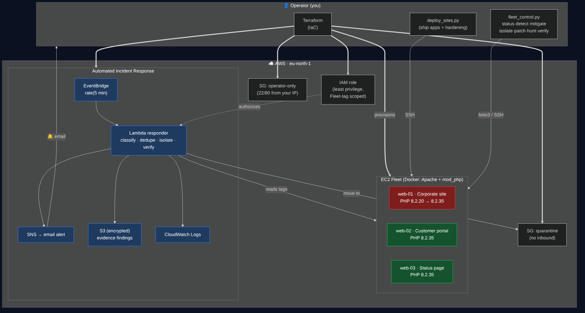
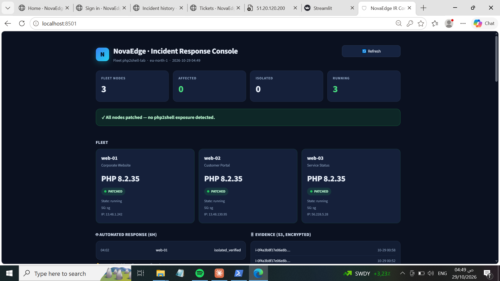
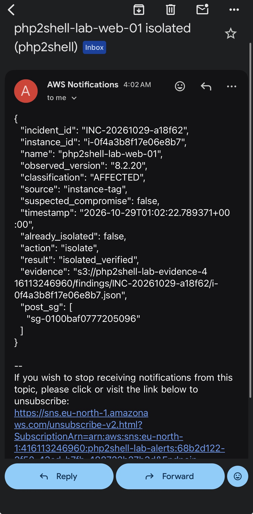
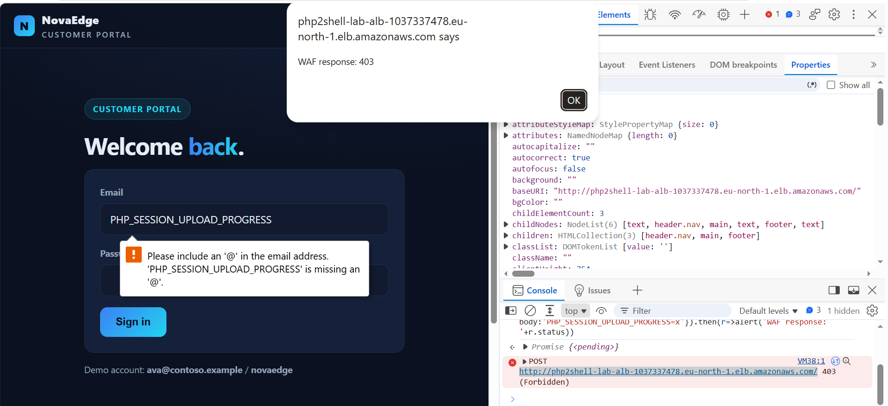
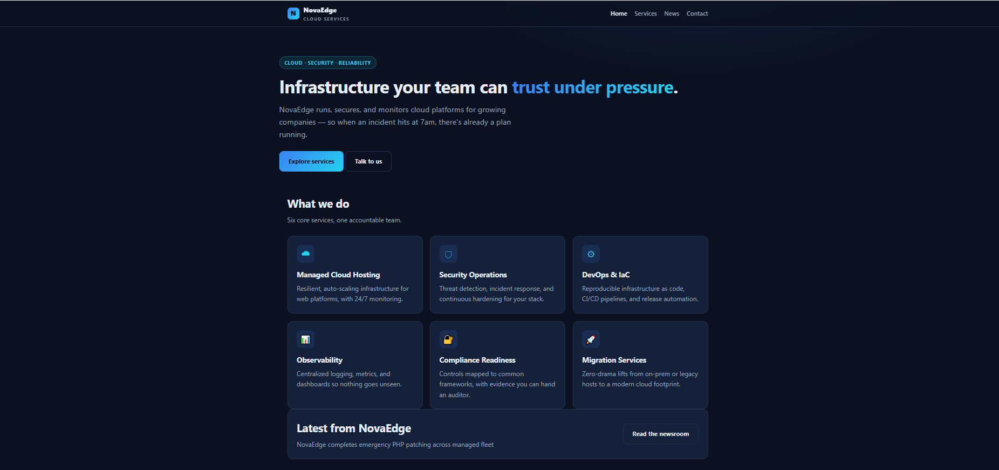
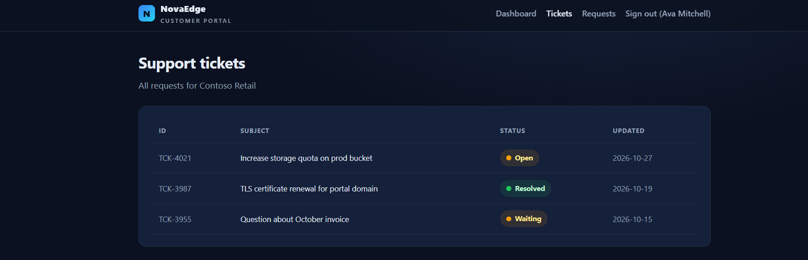
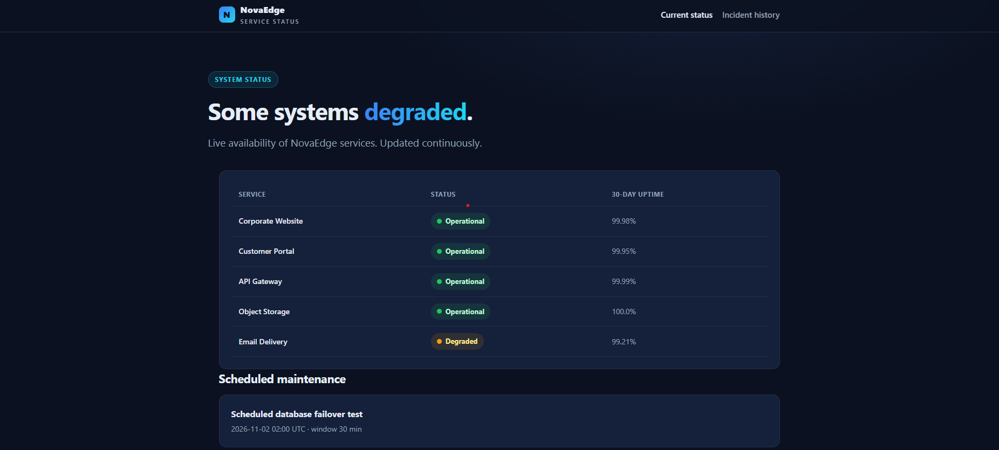

# php2shell Incident-Response Lab

A hands-on AWS **cloud incident-response** project. It simulates a small company's
server fleet during the real **php2shell** emergency (CVE-2026-109618 /
CVE-2026-109619 — unauthenticated RCE in PHP) and runs the full response
lifecycle — **detect → contain → remediate → verify** — with containment
**fully automated**.



## What it does

- **Detects** vulnerable PHP versions across the fleet from an authenticated
  management endpoint, and classifies each node AFFECTED / PATCHED / UNKNOWN.
- **Contains automatically** — a scheduled Lambda isolates an affected node
  (moves it to a no-inbound quarantine security group), writes evidence to
  encrypted S3, and emails an alert — no human needed.
- **Remediates** — upgrades the node to the patched PHP build and flips it healthy.
- **Verifies** — the same tool that proved exposure proves the fix.
- **Blocks attacks at the edge** — an AWS WAF in front of an ALB drops the
  php2shell request pattern before it reaches PHP, plus AWS managed rules and a
  per-IP rate limit.
- **Hardens the apps** — hides PHP/Apache version info, generic error pages, and
  keeps the real version behind a token-only endpoint.
- **Shows everything** — a one-command operator CLI and a protected Streamlit
  console for live fleet state, incidents, evidence, and response controls.

## The fleet

Three `t3.micro` nodes running NovaEdge (a fictional company): a corporate site,
a customer portal, and a service-status page — each a real PHP app on fictional
data.

| Node | Role | PHP |
|------|------|-----|
| `web-01` | Corporate website | 8.2.20 → 8.2.35 (the vulnerable one) |
| `web-02` | Customer portal (login, tickets) | 8.2.35 |
| `web-03` | Service-status page | 8.2.35 |

## Screenshots

**Incident-response console** — live fleet state, automated response, evidence, controls


**Automated containment** — a node is isolated and verified, with an alert emailed, no human in the loop


**Edge WAF blocks the php2shell attack** — the malicious request is dropped (403) before it reaches PHP


**The fleet** — corporate site, customer portal, service-status page

| | | |
|---|---|---|
|  |  |  |

## Tech stack

AWS (EC2, Lambda, EventBridge, SNS, S3, CloudWatch, ALB, AWS WAF, IAM) ·
Terraform · Docker · Python (boto3) · Streamlit · PHP/Apache

## Layout

```
terraform/   IaC: fleet, security groups, IAM, Lambda, EventBridge, SNS, S3, ALB + WAF
lambda/      the automated detector/responder
sites/       the three PHP apps + hardening + mgmt endpoint
fleet_control.py  operator CLI (status/detect/isolate/patch/verify/…)
dashboard.py      Streamlit incident-response console
proof/       exposure-verification evidence (no exploit code)
```

> Scope: exposure is proven by authoritative **version comparison**, not exploit
> code. There is no weaponised PoC in this repository.
