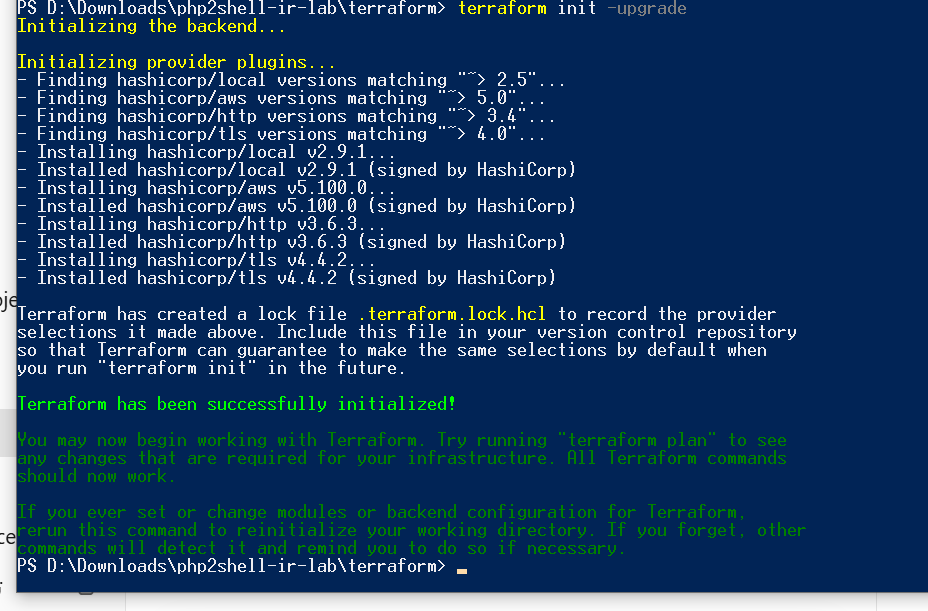
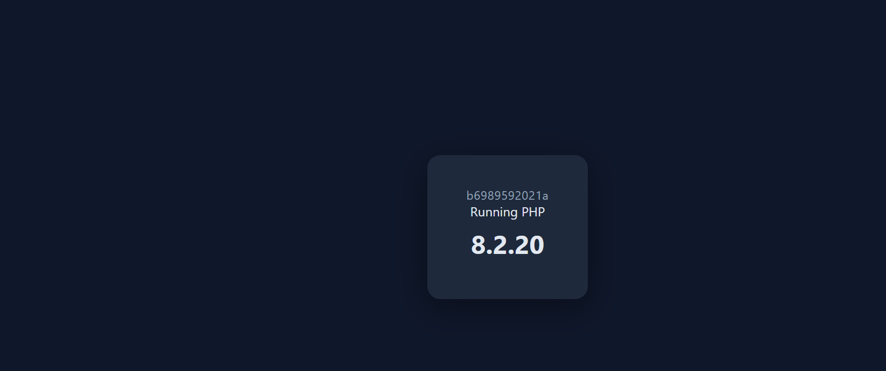
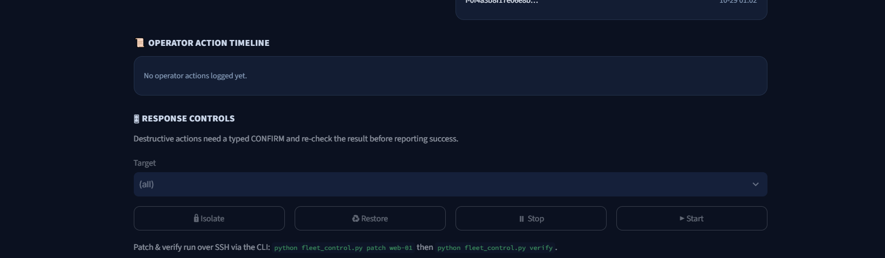

# AWS-php2shell-Incident-Response-Lab
# AWS php2shell Incident-Response & Auto-Remediation Lab

A hands-on cloud-security lab that simulates a company's web-server fleet during the real **php2shell** emergency (CVE-2026-109618 / CVE-2026-109619 — unauthenticated RCE in PHP) and runs the full response lifecycle — **detect → contain → remediate → verify** — with containment fully automated. Built on AWS as Infrastructure as Code for a Cloud Security / Incident Response portfolio.

---

## 🏗️ Environment

- **Cloud provider:** AWS (region `eu-north-1`)
- **Infrastructure as Code:** Terraform (one-command build & teardown)
- **Compute:** 3 × EC2 `t3.micro` fleet, PHP + Apache running as pinned Docker images
- **Fictional company (NovaEdge):** corporate website, customer portal, service-status page
- **Vulnerable workload:** `web-01` on PHP 8.2.20 · patched baseline 8.2.35
- **Security focus:** automated incident response, edge WAF, least-privilege IAM, information-disclosure hardening
- **Serverless automation:** EventBridge · Lambda · SNS · S3 (encrypted evidence) · CloudWatch
- **Edge protection:** Application Load Balancer + AWS WAF

---

## 🛠️ Implementation Steps

### 1. Environment Setup (Infrastructure as Code)
- Provisioned the whole fleet, security groups, IAM, and automation with Terraform.
- Each node runs PHP as a pinned Docker image (`php:<version>-apache`); access locked to the operator IP.
- A no-inbound **quarantine** security group is pre-built for isolation.



### 2. Exposure Verification — Proof (no exploit code)
- Confirmed exposure by **authoritative version comparison** against the official php2shell patched baselines — not by running an exploit.
- `web-01` boots on PHP **8.2.20** → below 8.2.35 → **AFFECTED**.



### 3. Automated Detection & Response (SOAR)
- A scheduled **EventBridge → Lambda** pipeline classifies each node AFFECTED / PATCHED / UNKNOWN.
- On an affected node it **isolates automatically** (moves it to the quarantine group), writes a finding to **encrypted S3**, and sends an **SNS email alert** — with least-privilege IAM and no human in the loop.


### 4. Remediation & Verification
- Upgraded the vulnerable node to the patched PHP build and flipped its tags healthy.
- Re-ran detection — the same tool that proved exposure proves the fix: **Verification PASSED**.
- One-command operator controls (isolate / restore / patch / stop / start) via CLI and dashboard.



### 5. Edge WAF Hardening
- Placed an **ALB + AWS WAF** in front of the fleet.
- A WAF rule drops the php2shell request pattern **before it reaches PHP** (verified: **403 Forbidden**), alongside AWS managed rule groups and a per-IP rate limit.


### 6. Application Hardening (Information Disclosure)
- `expose_php = Off`, `ServerTokens Prod`, `ServerSignature Off`, generic error pages.
- The real PHP version is served only from a token-authenticated management endpoint — kept out of all public pages.
- Three working PHP apps on fictional data (corporate site, customer portal, status page).


---

## 🧰 Tech Stack

AWS (EC2, Lambda, EventBridge, SNS, S3, CloudWatch, ALB, AWS WAF, IAM) · Terraform · Docker · Python (boto3) · Streamlit · PHP / Apache

---

## 👤 Author

**Name:** Mazen Reda
**Track:** Cloud Security / Incident Response

---

## 📐 Architecture

```
          Attacker / User traffic
                   |
                   v
        +-----------------------+
        |   AWS WAF  +  ALB     |   <-- blocks php2shell pattern (403)
        +-----------------------+
                   |
                   v
   +-------------------------------------+
   |        EC2 Fleet (eu-north-1)        |
   |  web-01   web-02   web-03            |
   |  8.2.20   8.2.35   8.2.35            |
   |  (vuln)   (ok)     (ok)             |
   +-------------------------------------+
                   |
     tags watched  |
                   v
   +-------------------------------------+
   |   Automated Incident Response       |
   |   EventBridge -> Lambda             |
   |     1. detect  (AFFECTED?)          |
   |     2. isolate -> quarantine SG     |
   |     3. evidence -> S3 (encrypted)   |
   |     4. alert   -> SNS email         |
   +-------------------------------------+
                   |
                   v
        Remediate (patch 8.2.35)  ->  Verify (PASSED)
```
